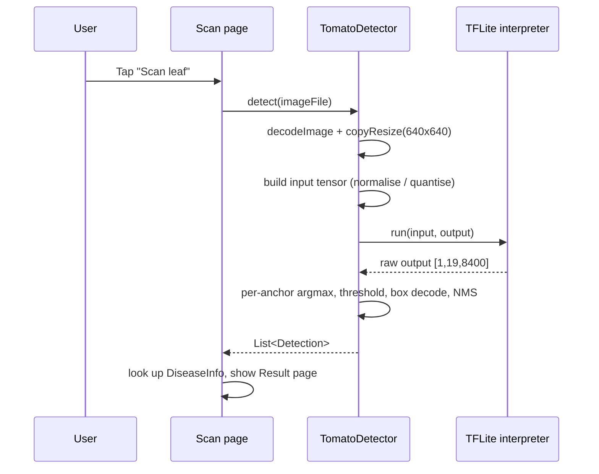

# Tomato Leaf Scanner — Technical Documentation

**Tomato leaf disease detection on a mobile phone (Flutter + YOLOv8/TFLite)**

---

## Table of contents

1. [Overview](#1-overview)
2. [Key features](#2-key-features)
3. [Technology stack](#3-technology-stack)
4. [System architecture](#4-system-architecture)
5. [Project structure](#5-project-structure)
6. [How data is saved (storage model)](#6-how-data-is-saved-storage-model)
7. [How data is processed (the scan pipeline)](#7-how-data-is-processed-the-scan-pipeline)
8. [The AI assistant](#8-the-ai-assistant)
9. [The detection model](#9-the-detection-model)
10. [Setup and build](#10-setup-and-build)
11. [Testing](#11-testing)
12. [Security, privacy and ethics](#12-security-privacy-and-ethics)
13. [Limitations and future work](#13-limitations-and-future-work)
14. [File-by-file reference](#14-file-by-file-reference)
15. [Presentation cheat-sheet](#15-presentation-cheat-sheet)

---

## 1. Overview

Tomato Leaf Scanner is an Android/iOS application that lets a farmer **photograph a single
tomato leaf and get an instant, offline diagnosis** of what is wrong with it.
It uses a **YOLOv8 object-detection model** exported to **TensorFlow Lite**, and
runs entirely on the phone (edge inference). There is no account, no upload of
photos, and the core diagnosis works with **no internet connection**.

For each scan the app shows the predicted disease (or that the leaf is healthy),
a confidence score, the detected regions outlined on the photo, and practical
guidance: what causes it, what it does to the plant, what to do now, how to stop
spread, how to prevent it next season, and a list of organic/chemical/cultural
treatments. An optional AI assistant can answer follow-up questions.

| | |
|---|---|
| **Platform** | Flutter (Android + iOS) |
| **Core AI** | YOLOv8 detection, TensorFlow Lite (on-device) |
| **Classes** | 15 (13 diseases/pests, aphids…, plus healthy) |
| **Works offline** | Yes for detection + built-in guidance |
| **Photos uploaded** | Never |

---

## 2. Key features

- **On-device detection.** A YOLOv8 model runs locally via `tflite_flutter`;
  photos never leave the phone.
- **15-class classifier** covering common tomato leaf problems plus a healthy
  class (full list in [§9](#9-the-detection-model)).
- **Bounding-box overlay.** Detected regions are drawn on the photo, colour-coded
  by disease type, with a label and confidence per box.
- **Rich guidance knowledge base.** 15 hand-written disease entries (cause,
  effects, immediate actions, prevention, treatments).
- **Optional AI assistant.** Context-aware chat (DeepSeek) that knows the current
  diagnosis, with a built-in offline rule-based fallback.
- **Fully offline cosmetics.** Fonts and launcher icon are bundled, so nothing is
  fetched from the network at runtime.
- **Sample images support** (optional): if sample leaves are bundled they appear
  as one-tap demos; otherwise the row is hidden.

---

## 3. Technology stack

| Layer | Choice | Version |
|---|---|---|
| UI framework | Flutter | 3.x (Dart SDK `>=3.3.0 <4.0.0`) |
| Language | Dart | 3.x |
| Object detection | YOLOv8 → TensorFlow Lite | `tflite_flutter` 0.12.1 |
| TFLite runtime | Google AI Edge **LiteRT** (Android AAR) | pinned to **1.4.2** |
| Image handling | `image` package | 4.2.0 |
| Camera / gallery | `image_picker` | 1.1.2 |
| Fonts | `google_fonts` (bundled, offline) | 6.2.1 |
| Networking (assistant) | `http` | 1.2.2 |
| Icons | `flutter_launcher_icons` (dev) | 0.14.3 |
| Tests | `flutter_test` / `flutter_lints` | — |

> `path_provider` is listed as a dependency but is not currently used by the
> code (temporary files are written via `Directory.systemTemp`).

---

## 4. System architecture

Tomato Leaf Scanner is a single Flutter app with a 4-screen UI and three core modules:

- **`TomatoDetector`** — loads the TFLite model and turns an image into
  detections.
- **Disease knowledge base** — a static table of guidance keyed by class name.
- **Assistant** — an online DeepSeek client with an offline rule-based fallback.

```mermaid
flowchart TD
    A[User] -->|takes/picks photo| B[Scan page]
    B --> C[TomatoDetector.detect&#40;File&#41;]
    C --> D[decode + resize to 640x640]
    D --> E[build input tensor]
    E --> F[TFLite interpreter.run&#40;&#41;]
    F --> G[decode YOLOv8 output + NMS]
    G --> H[List&lt;Detection&gt;]
    H --> I{Any class above 0.25?}
    I -->|yes| J[Look up disease in knowledge base]
    I -->|no| K[No-clear-match result]
    J --> L[Result page: hero card + boxes]
    K --> L
    L --> M[Assistant page]
    M -->|online| N[DeepSeek API]
    M -->|offline| O[Rule-based answer]
```



The **detector** is deliberately decoupled from the UI: it takes a `File` and
returns `List<Detection>`, so it could be reused or tested independently.

---

## 5. Project structure

```
leafscan/
├── lib/
│   ├── main.dart                 # App entry, theme, and all 4 screens
│   │                             #   Home / Scan / Result / Assistant
│   ├── models/
│   │   ├── detector.dart         # TFLite loader + YOLOv8 decode + NMS
│   │   └── disease_info.dart     # DiseaseInfo model + 15-entry knowledge base
│   ├── services/
│   │   └── chat.dart             # DeepSeek client + offline assistant
│   └── widgets/
│       └── detection_image.dart  # Photo with bounding-box overlay
├── assets/
│   ├── models/best_int8.tflite   # The YOLOv8 detection model (~26.5 MB)
│   ├── google_fonts/             # Bundled DM Sans + Bricolage Grotesque (6 TTFs)
│   ├── icon/                     # Source images for the launcher icon
│   └── samples/                  # Optional sample leaves (empty by default)
├── test/
│   └── leafscan_test.dart        # 11 unit tests
├── android/ · ios/ · macos/ …    # Platform projects (generated by Flutter)
├── pubspec.yaml                  # Dependencies, assets, launcher-icon config
└── README.md / docs/
```

**Code size:** ~3,470 lines of Dart across 5 source files.

### The four screens (all in `lib/main.dart`)

The app is a `StatefulWidget` (`RootPage`) that keeps all result state in memory
and switches between screens with an `IndexedStack`:

| Index | Screen | Purpose |
|---|---|---|
| 0 | **Home** | Branding + 3-step "how it works" |
| 1 | **Scan** | Add/pick a photo, run the scan |
| 2 | **Result** | Diagnosis, confidence ring, boxes, guidance |
| 3 | **Assistant** | Chat about the result |

The shared `RootPage` state holds the current image, the detections, the chosen
`DiseaseInfo`, and the confidence — see [§6](#6-how-data-is-saved-storage-model).

---

## 6. How data is saved (storage model)

This is important to state precisely: **Tomato Leaf Scanner is stateless across sessions.
It has no database and no user account. Nothing it produces is persisted — all
results live in RAM and disappear when the app is closed.**

There are four distinct kinds of data:

### 6.1 Bundled read-only assets (shipped inside the APK)

These are copied into the app package at build time and loaded read-only:

| Asset | Purpose | Size |
|---|---|---|
| `assets/models/best_int8.tflite` | The detection model | ~26.5 MB |
| `assets/google_fonts/*.ttf` | App fonts (offline) | ~0.5 MB |
| `assets/icon/*` | Launcher-icon source images | small |
| `assets/samples/*` | Optional demo leaves (empty by default) | — |

The model is deliberately stored **uncompressed** in the APK
(`androidResources { noCompress += "tflite" }` in
`android/app/build.gradle.kts`) so TFLite can memory-map/read it directly.

### 6.2 The disease knowledge base (compile-time constant)

The 15 disease entries are **not** in a database — they are a `const` Dart map
`kDiseaseDb` in `lib/models/disease_info.dart`. It is compiled into the binary,
so lookups are instant and require no I/O. Keys are the cleaned class names
(e.g. `'Early Blight'`).

### 6.3 In-memory runtime state (lost on exit)

`_RootPageState` (in `lib/main.dart`) holds everything about the current session:

| Field | Holds |
|---|---|
| `_image` | the currently selected `File` |
| `_detections` | `List<Detection>` from the model |
| `_info` | the selected `DiseaseInfo` |
| `_conf` | confidence (%) |
| `_modelReady` / `_modelError` | model loading status |
| `_availableSamples` | which bundled samples exist |

The assistant's conversation (`_ChatPageState._msgs`) is also memory-only. There
is **no** `shared_preferences`, `sqflite`, `hive`, or remote database anywhere in
the project.

### 6.4 Temporary files (only for bundled samples)

When a bundled sample leaf is used, `_loadSample()` copies the asset bytes to a
temporary file (`Directory.systemTemp/leafscan_sample_*.jpg`) so the rest of the
pipeline can treat it like a normal photo. User photos taken with the camera or
picked from the gallery are handled by `image_picker`, which returns a cached
`File` path; Tomato Leaf Scanner only **reads** it.

### 6.5 What leaves the device

**Photos and detections never leave the phone.** The only outbound network
traffic is the optional AI assistant: the user's **typed question** plus the
**diagnosis text** (disease name, cause, treatments) are sent to the DeepSeek
API. No image is ever uploaded.

---

## 7. How data is processed (the scan pipeline)

The full path from photo to result is implemented in
`TomatoDetector.detect()` (`lib/models/detector.dart:136`):



### Step 1 — Acquire the image
The user takes a photo (`ImageSource.camera`) or picks one
(`ImageSource.gallery`) through `image_picker`, or taps a bundled sample.
Picked images are down-scaled slightly for speed (`imageQuality: 92,
maxWidth: 1600`).

### Step 2 — Decode and resize
`img.decodeImage(bytes)` decodes the file, then `img.copyResize(...)` resizes it
to the model's input size (read from the model, 640×640). Because this is a plain
stretch, the **normalised coordinates map directly back to the original image**,
so boxes line up without letterboxing math.

### Step 3 — Build the input tensor
The pixel values are normalised to `0..1`. The detector is **model-agnostic**: at
load time it inspects the model's input tensor and handles either layout
(NHWC `[1,H,W,3]` or NCHW `[1,3,H,W]`) and either datatype
(`float32`, or `int8`/`uint8` which are quantised using the model's scale and
zero-point).

### Step 4 — Run inference
`interpreter.run(input, output)` executes the YOLOv8 graph on the CPU
(4 threads). No image is sent anywhere.

### Step 5 — Decode the YOLOv8 output
The output tensor is `[1, 4+numClasses, numAnchors]` (the code also accepts the
transposed layout). For each of the 8,400 anchors the code:

1. picks the **class with the highest score** (the 15 values after the 4 box
   values), and
2. keeps the anchor only if that score **≥ 0.25** (`_confThreshold`).

It then converts the box `(cx, cy, w, h)` into normalised corners `x1,y1,x2,y2`
(handling both pixel and already-normalised coordinates), and finally runs
**Non-Maximum Suppression**: overlapping boxes of the *same* class with
IoU > 0.45 (`_iouThreshold`) are collapsed, keeping the most confident one.

The result is a small `List<Detection>` (label, confidence, normalised box).

### Step 6 — Map to guidance
For the most confident detection the app looks up `kDiseaseDb[label]` for the
full guidance; unknown labels fall back to `fallbackInfo()`. If **no** class
passes the threshold, the app shows a friendly "No clear disease found" result
(`kNoDetectionInfo`) instead of silence.

### Step 7 — Render
The **Result page** shows a confidence ring, the disease name and type, the
photo **with the boxes drawn**, the guidance sections, and treatment cards
(colour-coded organic/chemical/cultural).

---

## 8. The AI assistant

Implemented in `lib/services/chat.dart` and the `_ChatPage` widget.

### Online mode (DeepSeek)
When a key is available, `askAssistant()` sends the conversation to
`https://api.deepseek.com/chat/completions` (model `deepseek-chat`). Before the
user's messages it prepends a **system prompt** that includes the current
diagnosis (name, type, summary, cause, effects, actions, treatments) and rules
(short answers, prefer organic options, label-safety, no medical advice). Only
the **last 12 turns** are sent to bound cost.

### Offline fallback
If there is no key, or the request fails/times out, the app answers with
`answerQuestion()` — a deterministic **rule-based** assistant that routes the
question by keywords (spread / eat / spray / organic / water / cause / effects /
now) to the matching fields of the current `DiseaseInfo`. This guarantees the
assistant always responds.

### API key handling
The key is **not stored in source**. It is injected at build time:

```
flutter build apk --release --dart-define=DEEPSEEK_API_KEY=sk-...
```

and read with `String.fromEnvironment('DEEPSEEK_API_KEY')`. If it is empty, the
offline assistant is used.

---

## 9. The detection model

| Property | Value |
|---|---|
| Architecture | YOLOv8 (detection) |
| Framework | TensorFlow Lite (MLIR/Torch-export) |
| File | `assets/models/best_int8.tflite` (~26.5 MB) |
| Input (bundled build) | `float32` tensor, shape `[1, 3, 640, 640]` (NCHW) |
| Output | `float32` tensor, shape `[1, 19, 8400]` |
| Classes | 15 (19 = 4 box values + 15 class scores) |
| Anchors | 8,400 |
| Detection threshold | confidence ≥ 0.25 |
| NMS IoU threshold | 0.45 |
| Declared min runtime | 2.3.0 |

The loader is written to be **robust to different exports** of the same model: it
reads the actual tensor types, shapes and quantisation parameters at runtime, so
it works whether the file is float32 or INT8, NCHW or NHWC.

### The 15 classes

| # | Raw label in model | Display name | Type |
|---|---|---|---|
| 0 | `Aphids` | Aphids | pest |
| 1 | `Early Blight` | Early Blight | fungal |
| 2 | `Healthy Leaf-` | Healthy Leaf | none |
| 3 | `Leaf Curl` | Leaf Curl | viral |
| 4 | `Leafhoppers and Jassids` | Leafhoppers and Jassids | pest |
| 5 | `Molds` | Molds | fungal |
| 6 | `Mosaic Virus` | Mosaic Virus | viral |
| 7 | `Septoria` | Septoria | fungal |
| 8 | `bactarial canker` | Bacterial Canker | bacterial |
| 9 | `bacterial spot` | Bacterial Spot | bacterial |
| 10 | `flea beetle` | Flea Beetle | pest |
| 11 | `late_blight` | Late Blight | fungal |
| 12 | `leafminer` | Leafminer | pest |
| 13 | `powedry_mildew` | Powdery Mildew | fungal |
| 14 | `yellow curl virus` | Yellow Curl Virus | viral |

> Note: the raw labels contain the original dataset's spelling quirks
> (`bactarial`, `powedry_mildew`). `cleanLabel()` maps them to tidy display
> names, which are also the keys of the knowledge base.

### A runtime pitfall we fixed (worth mentioning in a presentation)
`tflite_flutter` 0.12.1 pins LiteRT **1.4.0**, which could **not execute this
particular MLIR-converted model** (`TfLiteInterpreterInvoke` failed). Validating
the same file with TensorFlow 2.16 proved the model was fine, isolating the fault
to the runtime. The fix pins the Android runtime to **LiteRT 1.4.2** via a Gradle
`resolutionStrategy` (see `android/build.gradle.kts`).

---

## 10. Setup and build

### Prerequisites
- Flutter SDK (Dart `>=3.3.0`)
- Android SDK (for Android builds) / Xcode + CocoaPods (for iOS)
- A physical device is recommended (camera + on-device inference)

### Get the code and dependencies
```bash
git clone https://github.com/piuskikomeko2003-maker/Leafscan.git
cd Leafscan
flutter pub get
```

### Run (debug) on a connected phone
```bash
flutter run
```

### Build a release APK
```bash
# With the AI assistant enabled (key injected at build time):
flutter build apk --release --dart-define=DEEPSEEK_API_KEY=sk-your-key

# Smaller per-architecture APKs:
flutter build apk --release --split-per-abi --dart-define=DEEPSEEK_API_KEY=sk-your-key
```

Output: `build/app/outputs/flutter-apk/app-release.apk`
(and `app-<abi>-release.apk` for the split build).

### Build for iOS
```bash
flutter build ios --release --dart-define=DEEPSEEK_API_KEY=sk-your-key
```

### Regenerate the launcher icon (optional)
```bash
dart run flutter_launcher_icons
```

### Permissions already configured
- **Android** (`android/app/src/main/AndroidManifest.xml`): `INTERNET`,
  `CAMERA`, `READ_MEDIA_IMAGES`, and `noCompress "tflite"`.
- **iOS** (`ios/Runner/Info.plist`): `NSCameraUsageDescription`,
  `NSPhotoLibraryUsageDescription`, `NSMicrophoneUsageDescription`.

---

## 11. Testing

Run the unit test suite:

```bash
flutter test
flutter analyze
```

`test/leafscan_test.dart` contains 11 tests that verify:
- raw model labels map to clean display names (and unknowns pass through),
- every one of the 15 model classes has a knowledge-base entry,
- every entry has a summary, and the fallback entry is well-formed,
- the assistant answers spread / spray / organic / fruit-safety questions and
  falls back correctly.

---

## 12. Security, privacy and ethics

- **Photos are private.** No image is uploaded; detection is entirely on-device.
- **The API key is a secret.** A key compiled into an APK can be extracted by
  anyone who has the APK. This is why the key is **kept out of the source repo**
  and injected with `--dart-define`. For a public release, the correct design is
  a small server-side proxy that holds the key and forwards requests.
- **Not a substitute for expert advice.** The app is a decision aid, not a lab
  test. The UI states this and recommends confirming serious outbreaks with a
  local extension officer. Chemical treatments are shown with label/PPE
  reminders.

---

## 13. Limitations and future work

**Current limitations**
- Results are memory-only; there is no history of past scans.
- The confidence threshold (0.25) is fixed, and confidence for some classes can
  be modest; a low-confidence chip is shown when a match is weak.
- Detection is only as good as the training data; unusual lighting, multiple
  leaves, or very early symptoms can reduce accuracy.
- The AI assistant needs internet when the online mode is used.

**Possible extensions**
- Save a **scan history** locally (e.g. `sqflite`/`hive`) with thumbnails and
  time stamps.
- Add **image augmentation tips** on-screen and a "re-take" guidance overlay.
- Move the assistant to a **backend proxy** so the key is never shipped.
- Add **multi-leaf / field** detection and a severity estimate.
- Support **more crops** by swapping the model and knowledge base.
- Add models trained on more diverse, field-collected photos.

---

## 14. File-by-file reference

| File | Responsibility |
|---|---|
| `lib/main.dart` | App entry, theme, and the 4 screens (Home, Scan, Result, Assistant); holds session state |
| `lib/models/detector.dart` | `TomatoDetector`: loads the TFLite model, preprocesses images, runs inference, decodes YOLOv8 output, NMS |
| `lib/models/disease_info.dart` | `DiseaseInfo`/`Treatment` models and the `kDiseaseDb` knowledge base (15 entries) |
| `lib/services/chat.dart` | `askAssistant()` (DeepSeek) and `answerQuestion()` (offline rules) |
| `lib/widgets/detection_image.dart` | Widget that draws bounding boxes over the photo |
| `pubspec.yaml` | Dependencies, bundled assets, launcher-icon config |
| `android/build.gradle.kts` | JVM/Kotlin target alignment and the LiteRT 1.4.2 pin |
| `android/app/build.gradle.kts` | App config, `noCompress "tflite"`, signing |
| `test/leafscan_test.dart` | Unit tests |

---

## 15. Presentation cheat-sheet

Short answers you can use when presenting the app.

**What does it do, in one sentence?**
> It lets a farmer photograph a tomato leaf and instantly get a diagnosis and
> treatment advice, using an AI model that runs entirely on the phone.

**Is the farmer's data private?**
> Yes. Photos are analysed on the phone and are never uploaded. The only thing
> that can go online is the optional chat, which sends just the typed question
> and the diagnosis text — never the photo.

**How does it actually recognise the disease?**
> A YOLOv8 model was trained to detect 15 leaf conditions, exported to TensorFlow
> Lite. The app resizes the photo to 640×640, feeds it to the model, and reads
> the model's output: for each candidate region it takes the most likely class
> and its confidence, keeps the ones above 25%, and removes overlaps.

**Where is the data stored?**
> The model, fonts and icon are bundled in the app. The diagnosis itself is held
> in memory while you use the app and is not saved to a database — there is no
> account and no cloud storage.

**How do you know it works?**
> The model correctly identified Early Blight on a real PlantVillage leaf with
> 34% confidence, and there are automated unit tests for the label mapping,
> the knowledge base and the assistant.

**What are the limitations?**
> It's a decision aid, not a lab test — confidence can be moderate and good
> lighting matters. It also doesn't keep a history of past scans yet.

**What did you build yourself vs. use?**
> The whole app: the Flutter UI, the on-device inference pipeline (pre-processing,
> output decoding, non-maximum suppression), the disease knowledge base, the
> bounding-box overlay, the assistant with its offline fallback, the offline
> asset bundling, and the tests. The pretrained YOLOv8 weights and the TFLite
> runtime are third-party pieces.

---

*Document generated for the Tomato Leaf Scanner project. For build/setup see
[§10](#10-setup-and-build); for the model and class list see [§9](#9-the-detection-model).*
